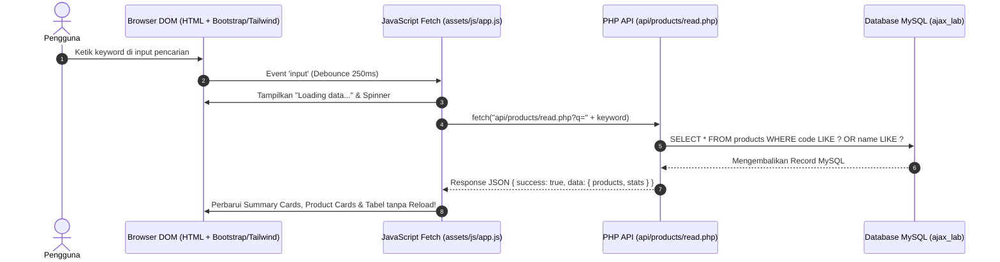

# Fullstack Product Dashboard: Integrasi Frontend & Backend

Proyek ini menggabungkan seluruh materi praktikum **Web Programming 1** yang terdiri dari 4 modul utama:
1. **Modul 11A - AJAX Fundamentals:** Live Search tanpa reload halaman menggunakan JavaScript `fetch()`, event listener, loading state, dan DOM update.
2. **Modul 11B - API Fundamentals:** Backend JSON REST API menggunakan PHP + MySQL (`mysqli`), prepared statement, status code (200, 201, 400, 404, 405, 500), dan response contract.
3. **Modul 11C - Bootstrap Fundamentals:** Responsive Product Dashboard UI dengan Bootstrap 5.3 CDN, Grid 12 kolom (`col-12 col-md-6 col-lg-4`), Navbar collapse, Summary Cards, Table Responsive, Form Preview, Alert, dan Modal.
4. **Modul 11D - Tailwind CSS Fundamentals:** Dashboard alternatif berbasis utility-first CSS dengan Tailwind Play CDN (`tailwind.php`) yang mengonsumsi endpoint API yang sama.

---

## 🏗️ Struktur Direktori Proyek

```text
frontend&backend/
├── index.php                 # Frontend Utama: Bootstrap 5.3 Dashboard + AJAX Controller
├── tailwind.php              # Frontend Alternatif: Tailwind CSS Dashboard (Modul 11D)
├── traditional.php           # Baseline Pembanding: Traditional Search dengan Full Page Reload (Modul 11A)
├── database.sql              # Skrip SQL: Membuat database 'ajax_lab' & tabel 'products'
│
├── config/
│   ├── koneksi.php           # Koneksi Database MySQLi dengan charset utf8mb4 & error handler
│   └── response.php          # Helper sendJson() untuk respon JSON berstandar (Modul 11B)
│
├── api/
│   ├── hello.php             # Endpoint Pengujian API (Modul 11B Checkpoint 3)
│   └── products/             # REST API CRUD Produk (Modul 11B & 11A)
│       ├── read.php          # GET: Daftar produk + Live Search (?q=...) + Summary Stats
│       ├── detail.php        # GET: Detail 1 produk berdasarkan (?id=...)
│       ├── create.php        # POST: Tambah produk baru dengan validasi server
│       ├── update.php        # POST: Ubah produk berdasarkan ID
│       ├── delete.php        # POST: Hapus produk berdasarkan ID
│       └── stats.php         # GET: Statistik ringkasan untuk dashboard cards
│
├── assets/
│   ├── css/
│   │   └── custom.css        # Custom CSS: Card hover transition, scroll margin, badge styling (Modul 11C)
│   └── js/
│       ├── app.js            # Controller AJAX Utama (Bootstrap UI): Fetch, Debounce Search, Modal CRUD, DOM Render
│       └── tailwind-app.js   # Controller AJAX (Tailwind UI): Konsumsi API yang sama
│
└── tester/
    └── index.php             # HTML Form Tester untuk pengujian API langsung (Modul 11B Checkpoint 9)
```

---

## 🚀 Cara Menjalankan Proyek

### Opsi A: Menggunakan Laragon / XAMPP (Direkomendasikan)
1. Buka **Laragon** atau **XAMPP**, lalu klik **Start All** (pastikan Apache dan MySQL aktif).
2. Salin folder proyek ini ke dalam direktori web root server:
   - Laragon: `C:\laragon\www\frontend-backend`
   - XAMPP: `C:\xampp\htdocs\frontend-backend`
3. Buka **phpMyAdmin** (`http://localhost/phpmyadmin`).
4. Buat database baru bernama `ajax_lab` atau import langsung file `database.sql`.
5. Buka browser dan akses:
   - **Frontend Bootstrap (Utama):** `http://localhost/frontend-backend/index.php`
   - **Frontend Tailwind:** `http://localhost/frontend-backend/tailwind.php`
   - **Traditional Search (Modul 11A baseline):** `http://localhost/frontend-backend/traditional.php`
   - **API Tester (Modul 11B):** `http://localhost/frontend-backend/tester/`

### Opsi B: Menggunakan PHP Built-in Server
Jika MySQL Anda sudah berjalan di port 3306 (user `root`, password kosong):
```powershell
# Jalankan di terminal workspace ini:
php -S localhost:8000
```
Lalu buka di browser: `http://localhost:8000/index.php`.

---

## 🔄 Alur Integrasi Frontend & Backend (The Bridge)



---

## 📋 API Contract

| Endpoint | Method | Parameter Input | HTTP Status Code | Deskripsi |
| :--- | :--- | :--- | :--- | :--- |
| `/api/hello.php` | `GET` | - | `200 OK` | Informasi versi dan endpoint API |
| `/api/products/read.php` | `GET` | `q` (opsional), `category` (opsional) | `200 OK`, `500 Error` | Menampilkan seluruh produk, live search, & stats |
| `/api/products/detail.php` | `GET` | `id` (wajib di query string) | `200 OK`, `400 Bad Request`, `404 Not Found` | Menampilkan data spesifik 1 produk |
| `/api/products/create.php` | `POST` | `name`, `category`, `price`, `stock`, `status` | `201 Created`, `400 Bad Request` | Menyimpan produk baru ke database |
| `/api/products/update.php` | `POST` | `id`, `name`, `category`, `price`, `stock`, `status` | `200 OK`, `400 Bad Request`, `404 Not Found` | Memperbarui data produk yang ada |
| `/api/products/delete.php` | `POST` | `id` (wajib) | `200 OK`, `400 Bad Request`, `404 Not Found` | Menghapus produk dari database |
| `/api/products/stats.php` | `GET` | - | `200 OK` | Mengambil data total produk, stok siap, dan low stock |

---

## 💡 Konsep Penting yang Direpresentasikan

1. **Bootstrap vs Native CSS (Modul 11C):**
   - Komponen siap pakai: `navbar`, `card`, `table`, `modal`, `alert`.
   - Grid 12 kolom: `col-12 col-md-6 col-lg-4` (Mobile 1 card, Tablet 2 cards, Desktop 3 cards).
   - Utilities: `d-flex`, `justify-content-between`, `gap-3`, `shadow-sm`, `border`.

2. **Tailwind vs Bootstrap (Modul 11D):**
   - Bootstrap menggunakan kelas komponen berpola (`btn btn-primary`).
   - Tailwind menggunakan susunan atomic utility (`px-4 py-2 bg-blue-600 text-white rounded-lg`).
   - Keduanya mengonsumsi satu backend API yang sama tanpa perlu mengubah logika server.

3. **Traditional Search vs AJAX Search (Modul 11A):**
   - Traditional (`traditional.php`): Form submit &rarr; Server reload &rarr; Dokumen HTML utuh baru.
   - AJAX (`index.php`): Input event &rarr; `fetch()` &rarr; JSON / Data &rarr; DOM update spesifik tanpa reload.
